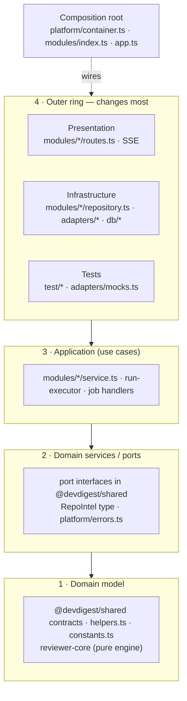

# Onion Architecture — DevDigest backend

Answers **"which ring does this code belong to, and what may it import?"** for `server/`.
Sources and rationale: [README.md](README.md). Worked examples: [examples.md](examples.md).

**Project rules win.** Read `server/CLAUDE.md` and `server/INSIGHTS.md` first (and
`src/modules/repo-intel/CLAUDE.md` when touching indexing). This skill maps Onion onto the
structure that already exists — it does **not** introduce `domain/ application/ infrastructure/`
folders. Keep `modules/<name>/{routes,service,repository,helpers,constants}.ts`.

Out of scope — use the sibling skill:
- Fastify plugins, hooks, schemas, serialization → `fastify-best-practices`
- Drizzle query / relation / migration syntax → `drizzle-orm-patterns`
- Postgres tables, types, indexes → `postgresql-table-design`
- Zod API → `zod`

## The four tenets (Palermo)

1. The application is built around an **independent domain model**.
2. **Inner rings define interfaces; outer rings implement them.**
3. **Coupling points toward the center** — code may depend on rings closer to the core, never on
   rings further out.
4. The core **compiles and runs without infrastructure** — it can be tested with no DB, no
   Fastify, no network.

"The database is not the center. It is external." So are GitHub, git, the LLM providers and HTTP.

## Rings in DevDigest



| Ring | In DevDigest | May import |
|---|---|---|
| 1 Domain model | Zod contracts + inferred types in `@devdigest/shared`; pure `helpers.ts`, `constants.ts`, `status.ts`; `@devdigest/reviewer-core` | ring 1 + pure libs (`zod`) |
| 2 Ports / domain services | adapter interfaces in `@devdigest/shared` (`LLMProvider`, `GitHubClient`, `GitClient`, `CodeIndex`, `SecretsProvider`, `AuthProvider`, `Embedder`), `RepoIntel` facade type, `AppError` family in `platform/errors.ts` | rings 1–2 |
| 3 Application | `modules/<name>/service.ts`, `reviews/run-executor.ts`, job handlers | rings 1–3 + the repository it owns + ports via `container` |
| 4 Infrastructure | `modules/<name>/repository.ts` (Drizzle), `adapters/*` (SDKs), `db/*` | anything inward; implements ports |
| 4 Presentation | `modules/<name>/routes.ts` (Fastify + `fastify-type-provider-zod`), SSE | its service, contracts, `_shared/context`, `_shared/schemas` |
| Composition root | `platform/container.ts`, `modules/index.ts`, `app.ts` | everything — the only place that `new`s adapters and shared repositories |

Full import matrix: [references/layers-and-rules.md](references/layers-and-rules.md).

## Dependency rule — MUST NOT

- **`routes.ts`** must not import `drizzle-orm`, `db/schema`, a `repository`, `container.db`,
  or call an adapter directly. It parses input, resolves context, calls **one** service method,
  sets the status code.
- **`service.ts`** must not import `fastify`, `drizzle-orm`, `db/schema`, or any SDK
  (`octokit`, `openai`, `@anthropic-ai/sdk`, `simple-git`, `@ast-grep/napi`), and must not read
  `process.env` (config comes from `container.config`, secrets from `container.secrets`).
- **`helpers.ts` / `constants.ts` / domain code** must not do I/O, take a `Container`, or call
  `Date.now()` / `Math.random()` / `crypto.randomUUID()` directly — accept them as arguments.
- **A module** must not import another module's `repository.ts` or `service.ts` internals. Go
  through a shared repository on the container (`container.agentsRepo`, `container.reviewRepo`)
  or a facade (`container.repoIntel`).
- **`reviewer-core`** must stay free of DB / GitHub / filesystem access.
- **Adapters** must not import feature modules; repositories must not call adapters or services.
- **New code** creates adapters and shared repositories only in `platform/container.ts`.
  `new XRepository(container.db)` inside a module's own service is accepted legacy for the
  module-private repository — don't spread it to other modules' repositories.

## Placement ladder — "where does X go?"

| You are adding… | Put it in |
|---|---|
| A new endpoint | `routes.ts` (schema + one service call) **and** a service method — always both |
| A use case / workflow / orchestration across repos and adapters | `service.ts` (split into `<verb>.service.ts` or `run-executor.ts`-style class if > ~300 lines) |
| A SQL query / Drizzle call | the owning module's `repository.ts` (or `repository/<entity>.repo.ts`) |
| A query over another module's table | that module's repository, exposed via the container — not a copy in yours |
| A call to GitHub / git / LLM / filesystem / CLI tool | an adapter behind a port in `@devdigest/shared`; the service calls the port |
| A pure rule (derive status, tally, rank, format, parse URL) | `helpers.ts` (or a named file like `status.ts`) — unit-test it |
| A literal / job kind / limit | `constants.ts` of the module |
| A request / response DTO | Zod contract in `server/src/vendor/shared` (mirror to `client/src/vendor/shared`) |
| An internal type used only by the module | `types.ts` of the module |
| A domain error | throw an `AppError` subclass (`NotFoundError`, `ValidationError`, `ExternalServiceError`) from the service; never `reply.status()` for business failures |
| A background job | handler method on the service, registered via `container.jobs.register` |
| An env value | `platform/config.ts` → `AppConfig`; secrets → `SecretsProvider` |
| A mock for tests | `adapters/mocks.ts` + a field in `ContainerOverrides` |

## Request flow

```
routes.ts      Zod schema parses params/body → getContext(container, req) → service.method(ctx, input)
service.ts     enforces rules, orchestrates repository + ports, maps rows → contract DTO, throws AppError
repository.ts  Drizzle queries, always scoped by workspaceId, returns rows or plain objects
adapters/*     SDK calls, translate SDK errors → ExternalServiceError
app.ts         error handler turns AppError / ZodError into the structured envelope
```

## Pragmatism

Onion is for long-lived code with real behavior, not ceremony:
- **Even a read-only endpoint gets a thin service method.** Route → repository directly is the
  first step of the leaks we already have.
- **No interface for a repository with one implementation.** Interfaces (ports) are for external
  systems and anything tests must swap. Repositories are tested against real Postgres (`*.it.test.ts`).
- **Don't map rows to rich domain classes** — the domain model here is the Zod contracts plus pure
  functions. Map rows to contract DTOs in the service (or in a repository `toX()` helper).
- **Don't refactor legacy leaks opportunistically** inside an unrelated change; note them instead.
  When you *do* touch a leaking route, move its queries into a repository as part of that change.

Ring-specific guides:
- Presentation (Fastify): [references/fastify.md](references/fastify.md)
- Infrastructure (Drizzle): [references/drizzle.md](references/drizzle.md)
- Ports, adapters, container, mocks: [references/ports-and-adapters.md](references/ports-and-adapters.md)
- Zod at the edges: [references/zod-boundaries.md](references/zod-boundaries.md)

## Before you finish

Run the checklist and grep recipes in [references/review-checklist.md](references/review-checklist.md).
Minimum: no new `drizzle-orm` / `db/schema` import outside `repository*` / `db/`; no `fastify` or
SDK import in a service; every new external call goes through a port with a mock.
