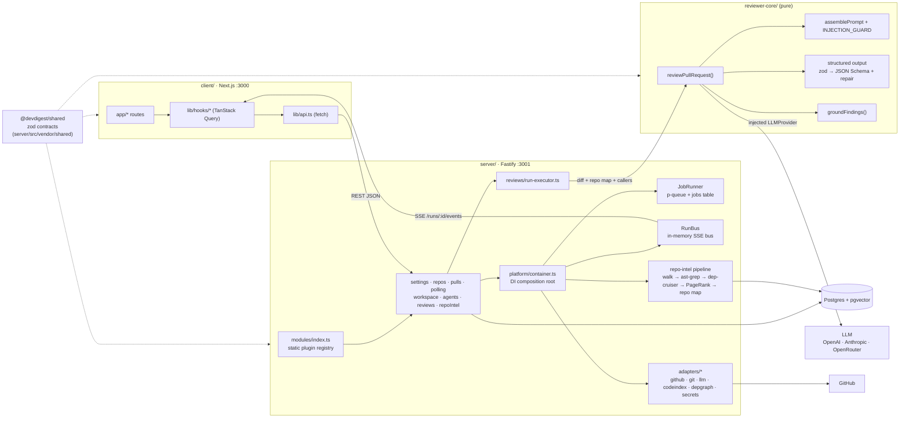
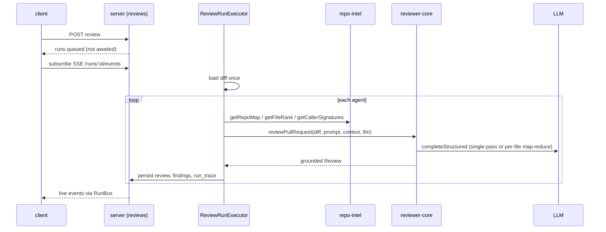

# Architecture — how the packages talk

High-level overview is in the [root README](../README.md#architecture). This page
shows the runtime wiring between packages and the review flow end to end.

## Module map

`client/src/vendor/shared` is a manual copy of the shared contracts; everything else
imports the server copy via tsconfig path aliases.

## Review flow

## Deeper docs

- Server request / DI flow: [server/README.md](../server/README.md#request--di-flow)
- repo-intel pipeline: [server/src/modules/repo-intel/README.md](../server/src/modules/repo-intel/README.md)
- Engine pipeline: [reviewer-core/README.md](../reviewer-core/README.md#pipeline)
- UI route map: [client/README.md](../client/README.md#ui-route-map)
